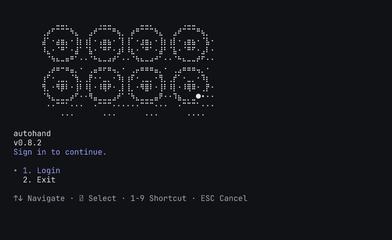

# Terminal branding

The sign-in screen uses a reusable animated Ink brand component. A returning authenticated launch shows a static welcome header using the same generated artwork and monochrome formatter. Selecting Login completes the startup presentation; successful authentication continues into the app without replaying the logo.

The source is `assets/autohand-logo.svg`, copied from the supplied `logo_dark_mode.svg`. Its eight stroked rings and eight filled centres are converted by ascii.rest's `fromSvg()` in braille style: 2×4 dots per terminal cell preserve the original curves. `scripts/generate-autohand-logo.ts` precomputes 120 scene frames in `src/utils/autohandLogoData.ts`. Startup selects a fixed canvas that fits the current columns and header rows, capped at 48×12 cells. Smaller layouts use 36×10, 28×8, or 24×6 cells. The converter is pinned to ascii.rest 0.4.0 as a development dependency; users run precomputed frames with no converter or SVG processing at startup.

The returning-user welcome gives interactive sessions a concise task hint. Before printing the mark, startup reserves space for the actual welcome, workspace notices, cached announcements, and wrapped composer footer. This keeps the full mark visible at standard 80×24 and 120×32 sizes; additional notices or smaller terminals reduce the mark to fit. Command-mode guidance retains its detailed command suggestions.

The logo floats, gently tilts, and changes perspective while a shaded moon passes in front and behind it. A dot layer gives the mark depth, and moving dots create surface detail. The 120 frames play at 15 frames per second on an eight-second loop. The canvas, wordmark, version, login choices, and help remain stationary. Logo cells use the terminal's normal foreground and background with no colour, bold, or dim overrides. Ink owns painting and keyboard input; the brand releases its interval and resize listener on unmount. The menu calculates its wrapped body height before giving the header its row budget, so shrinking the terminal preserves the sign-in options and keyboard guidance. Short terminals progressively use a smaller mark, then the wordmark.

Captured login animation from actual PTY output, rendered by the terminal emulator:



The startup input fallback is released once Ink attaches its input effects. Ink then parses normal and application-mode arrows, including split input sequences. Navigation and selection share a synchronous cursor reference so an arrow and Enter arriving together select the visible choice.

## Capabilities and accessibility

The renderer uses the existing terminal capability detector. `NO_COLOR` and `FORCE_COLOR=0` disable ANSI styling while the geometry continues to animate. They are not reduced-motion preferences. Non-TTY output and `TERM=dumb` use a plain still frame. Set `AUTOHAND_REDUCED_MOTION=1` for a still frame without an animation timer. The renderer leaves the terminal background and colour table alone. Braille and the moon's dot glyphs require a normal Unicode terminal font.

[Ghostty's terminfo](https://github.com/ghostty-org/ghostty/blob/main/src/terminfo/ghostty.zig) declares truecolour support and RGB foreground/background capabilities. [iTerm2 documents 256 and 24-bit colour support](https://iterm2.com/documentation-one-page.html#high-color-modes). [Microsoft documents the RGB and indexed ANSI sequences](https://learn.microsoft.com/en-us/windows/console/console-virtual-terminal-sequences#extended-colors) used by modern Windows terminal infrastructure. These are compatibility sources; native application verification remains a separate check.

## ascii.rest decision

[ascii.rest's image workflow](https://ascii.rest/docs/images/) converts artwork into animated cells. The generator uses its [SVG kit](https://ascii.rest/docs/kit-vector/) directly on the supplied mark, with named groups for the floating pose and glint. Depth and the moon are composed into those converted frames. Its [terminal player](https://ascii.rest/docs/terminal/) owns the alternate screen, cursor, and input; Ink already owns those resources in Autohand, so the live integration stays within Ink.

## Reproduce visual evidence

Run from the repository root:

```sh
node --import tsx src/testing/scenarios/captureStartupBranding.ts
node --import tsx src/testing/scenarios/captureStartupBranding.ts --returning-only
```

The utility launches the startup branding scenario in a PTY, polls the terminal buffer without waiting for idle, checks that two phases move the mark while retaining the identity and menu, and resizes to 32×18 and 32×12. It checks clean exit, cursor restoration, and absence of scrollback-clearing sequences. Captured terminal data, dark/light PNG previews, and an eight-second `startup-motion.gif` are written to `.artifacts/startup-branding/`. The GIF samples actual terminal cells at 10 frames per second; the live renderer runs at 15. Each dark/light PNG pair uses identical PTY cells and colours.

The returning-only command launches the built CLI with temporary authenticated config and local mock servers. It captures the 80×24 and 120×32 viewports after editing the composer, asserts that every logo row remains visible and was printed once, and checks clean exit and cursor restoration. `returning-report.json` identifies the exact built entry point by SHA-256. Default composer colours remain those emitted by the existing application; the light preview also exposes its current explicit dark input background.

`report.json` records an eight-second loop of actual animation output in bytes and PTY chunks per second, plus an isolated frame selection and formatting benchmark. PTY chunks may combine or split process writes. These measurements exclude startup and resize output. The images are terminal-emulator previews, not screenshots of native Ghostty, iTerm2, or Windows Terminal; the report labels all three native applications unverified.

Component tests cover rendering and timer cleanup. Tuistory covers terminal colour profiles, keyboard selection, reduced motion, monochrome output, cursor restoration, and resizing. Full validation remains tests, lint, and `bun run proof`.
